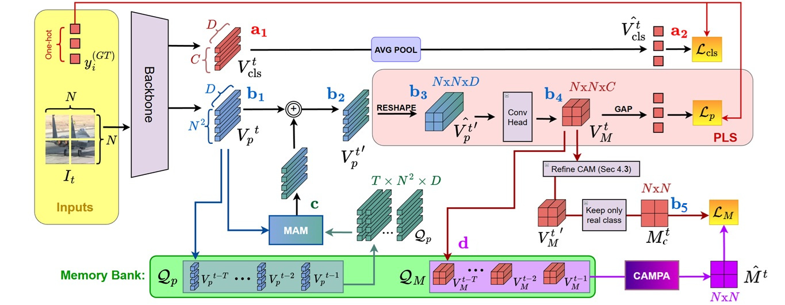

# MemCAM: Unlocking Cross-Attention in Label-Scarce Regimes

**A Weakly Supervised Approach for Video Semantic Segmentation**

**WACV 2027** &nbsp;·&nbsp; Paper (coming soon) &nbsp;·&nbsp; arXiv (coming soon)

---

> 🚧 **Code release in progress.** We are cleaning up the code and will release it here soon,
> together with pretrained weights and evaluation scripts. Star or watch the repository to be notified.



## Overview

Weakly Supervised Video Semantic Segmentation (WS-VSS) learns temporally consistent semantic masks
from video-level labels alone. Training inter-frame cross-attention under such weak supervision is
unstable and can even push a model below its single-frame baseline, which is why existing methods
rely on external priors such as optical flow.

**MemCAM** learns temporal cross-attention directly through feature-space self-supervision:

- **Memory Attention Module (MAM)**: a lightweight cross-attention block that refines the current
  frame with patch embeddings of the previous frames stored in a parameter-free Memory Bank.
- **CAM Propagation Algorithm (CAMPA)**: synthesizes a supervisory CAM for the current frame by
  propagating past CAMs according to patch-level feature similarities.
- **CAM Consistency Loss**: aligns the predicted CAM with the propagated one, providing the signal
  needed to train the temporal weights.


## Citation

If you find this work useful, please consider citing:

```bibtex
@inproceedings{marelli2027memcam,
  title     = {Unlocking Cross-Attention in Label-Scarce Regimes: A Weakly Supervised Approach for Video Semantic Segmentation},
  author    = {Marelli, Andrea and Ardenghi, Alessandro and Boracchi, Giacomo and Magri, Luca},
  booktitle = {Proceedings of the IEEE/CVF Winter Conference on Applications of Computer Vision (WACV)},
  year      = {2027}
}
```

## License

This project is released under the [Apache 2.0 License](LICENSE).

## Contact

For questions, please open an issue or contact
Andrea Marelli (andrea.marelli@polimi.it) or Alessandro Ardenghi (alessandro.ardenghi@studbocconi.it).
